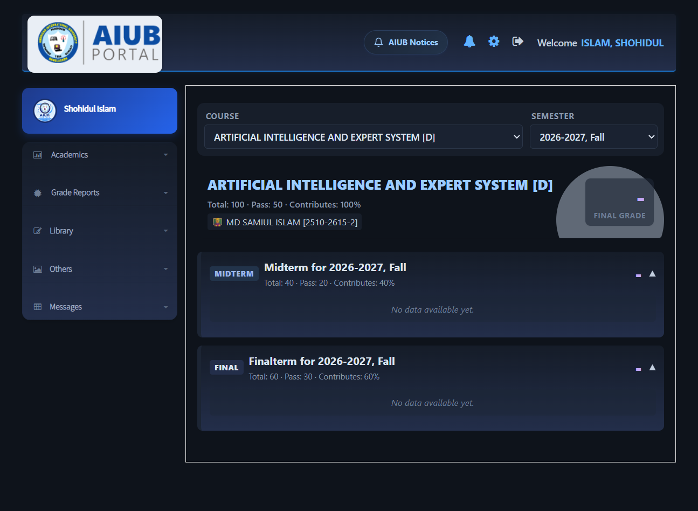
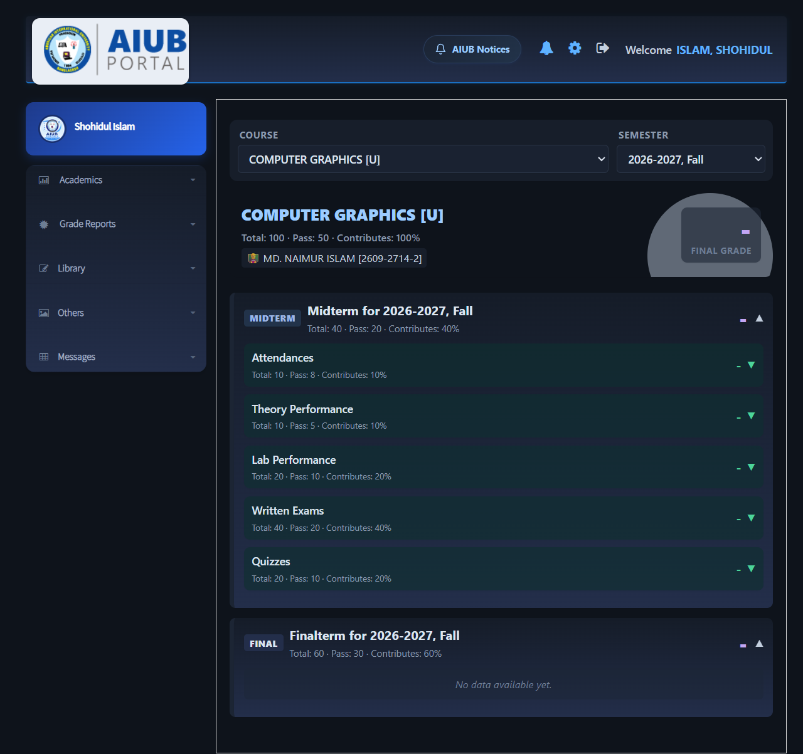
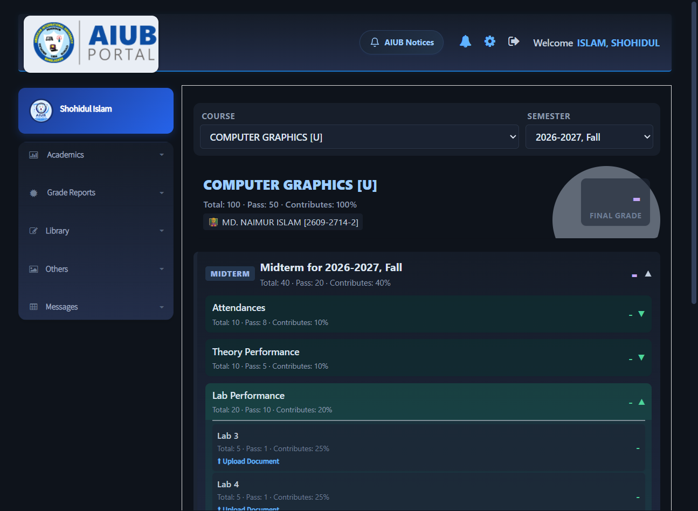
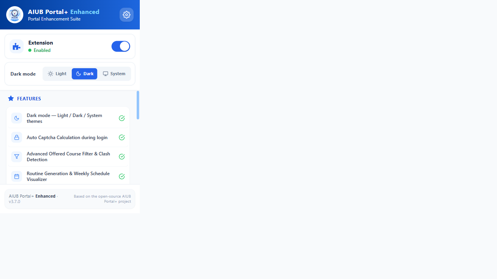

# 🌙 AIUB Portal+ Enhanced

A feature-complete enhancement suite for the
[American International University-Bangladesh student portal](https://portal.aiub.edu/)
— now with a **full dark mode**.

> This project is an enhanced fork of [**AIUB-Plus-Extenstion**](https://github.com/mdrijoanmaruf/AIUB-Plus-Extenstion)
> (“AIUB Portal+”) by **[Md Rijoan Maruf](https://github.com/mdrijoanmaruf)** — all credit for the original
> enhancement suite (captcha solver, course filters, clash detection, routine visualizer,
> notices, redesigned UI) goes to him. This fork adds dark mode, fixes, and polish.

[](https://github.com/Shishir-ip/AIUB-Plus-Extenstion-Enhanced/releases/latest)

| Dark dashboard | Dark course page |
| --- | --- |
|  |  |

| Upload Document links restored | Popup with theme switcher |
| --- | --- |
|  |  |

## ✨ What's enhanced in this fork

- 🌙 **Full dark mode** — a carefully tuned navy-tinted dark theme across the
  *entire* portal: login, dashboard, courses, registration, grade reports,
  financials, library, profile, messages — plus the extension's own redesigned
  components (sidebar, navbar, notices, cards).
- 🎛 **Three theme modes** — **Light / Dark / System** (follows your OS),
  switchable from the popup or the settings page. Applies **live** to open
  portal tabs, no reload needed.
- 🐛 **Fixed: “Upload Document” button vanished** — the original fork's course
  redesign erased the *Upload Document* links on course pages, making
  `/Student/Element/Upload` unreachable. They are now captured and re-rendered
  on every lab/quiz row.
- 🧼 **Consistency pass** — every hardcoded color in the suite was tokenized
  (`--apx-*`), so the redesigned UI and the underlying portal always share one
  palette per theme.
- 🖨 **Print-safe** — printing keeps the original light look.

### Everything from the original AIUB Portal+

Auto Captcha Calculation during login · Advanced Offered Course Filter & Clash
Detection · Routine Generation & Weekly Schedule Visualizer · Locked/Unlocked
Courses (CSE) · Live AIUB Notices inside the portal · Registration & Fee
Insights Cards · Redesigned Grades Dashboard · Financials Parsing & Payment
History · Drop Application Refund Panel · Exam Routine Countdown Timers ·
Redesigned Change Password Form · Shared UI (Sidebar, Navbar, Profile Widget)

## 📦 Installation

### ⚡ Direct download (recommended)

1. **[Download the extension zip from Releases](https://github.com/Shishir-ip/AIUB-Plus-Extenstion-Enhanced/releases/latest)**
   (e.g. `AIUB-Plus-Extenstion-Enhanced-v3.7.0.zip`).
2. **Extract** it anywhere — you get one folder containing `manifest.json`.
3. Open your browser's extensions page:
   - Chrome: `chrome://extensions` · Brave: `brave://extensions` · Edge: `edge://extensions`
4. Enable **Developer mode** (top right).
5. Click **Load unpacked** and select the extracted folder.
6. Open [portal.aiub.edu](https://portal.aiub.edu/) — dark mode is on by default.

> ⚠️ If you have the original **AIUB Portal+** installed, remove it first —
> running both together is what makes the portal look broken.

### 🔧 From source (for development)

```bash
git clone https://github.com/Shishir-ip/AIUB-Plus-Extenstion-Enhanced.git
cd AIUB-Plus-Extenstion-Enhanced
npm install
npm run build        # outputs the loadable extension to dist/
```

Then load the `dist/` folder via **Load unpacked**.

## ⌨️ Usage

| Action | How |
| --- | --- |
| Switch theme | Toolbar popup → **Dark mode** → Light / Dark / System |
| Per-feature toggles | Popup ⚙ → Settings dashboard |
| Master on/off | Popup top toggle (reloads the active portal tab) |
| Captcha solver | Automatic on the login page (toggle shown top-right) |

## 🗂 Project structure

```
src/
├── theme.css               # generated theme tokens + manual dark layers
├── content.css             # original AIUB+ filter styles
├── components/
│   ├── shared/             # contentBridge (theme dispatcher), Sidebar, Navbar
│   ├── academic/           # Course (with upload-link fix), Registration, …
│   ├── grade/              # By Curriculum / By Semester reports
│   ├── home/               # Dashboard widgets
│   ├── login/              # Captcha auto-solver (tesseract.js)
│   └── options/            # Settings dashboard (with Appearance section)
├── App.jsx                 # Popup (master toggle + theme switcher)
└── background/             # Service worker
tools/
├── recolor.mjs             # per-hex theme tokenizer (generates theme tokens)
└── fix-text-roles.mjs      # text/background role correction pass
```

The build uses **Vite + @crxjs** (React 19, Tailwind). `npm run build` regenerates
`dist/` and the theme tokens in `src/theme.css` stay in sync via the marker block.

## 🛠 How dark mode works

1. `contentBridge.jsx` (document_start) reads `theme` from
   `chrome.storage.sync` (`light` / `dark` / `system`), resolves *system*
   against `prefers-color-scheme`, and toggles the `apx-dark` class on `<html>`.
2. `theme.css` (loaded on every portal page) defines ~200 per-color tokens:
   light values are the **original upstream colors** (pixel-identical light
   theme), dark values are navy-tinted equivalents.
3. All extension components reference tokens, so their inline-styled UI flips
   live when the class changes.
4. A higher-specificity dark layer darkens the portal's own Bootstrap 3 UI,
   remaps Tailwind utility classes, and skins the AIUB+ filter panels.
5. Printing always reverts to light.

## 🧪 Tested live on

Login (dark + captcha solver) · Dashboard · Courses & Results (incl. Computer
Graphics lab upload links) · Registration · Grade Report · Financials ·
Library · Profile · Notification center · AIUB Notices dropdown ·
Light/Dark/System switching · Master enable/disable

## 🙏 Credits

- **[Md Rijoan Maruf](https://github.com/mdrijoanmaruf)** — creator of the
  original [AIUB Portal+](https://github.com/mdrijoanmaruf/AIUB-Plus-Extenstion).
  This fork would not exist without his work.
- **[Shishir-ip](https://github.com/Shishir-ip)** — dark mode theme system,
  Upload Document fix, consistency pass, and maintenance of this fork.

## 📄 License

MIT — see [LICENSE](LICENSE). The original AIUB Portal+ is also MIT licensed.

---

Made with 💙 for AIUB students. Not affiliated with or endorsed by
American International University-Bangladesh.
